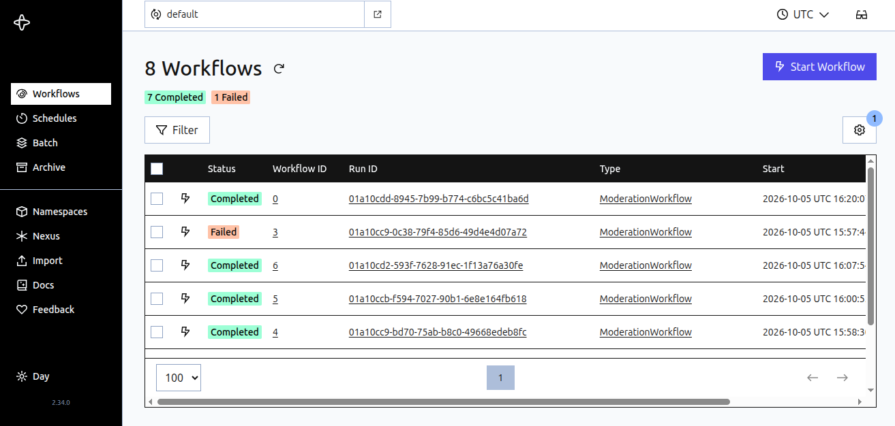
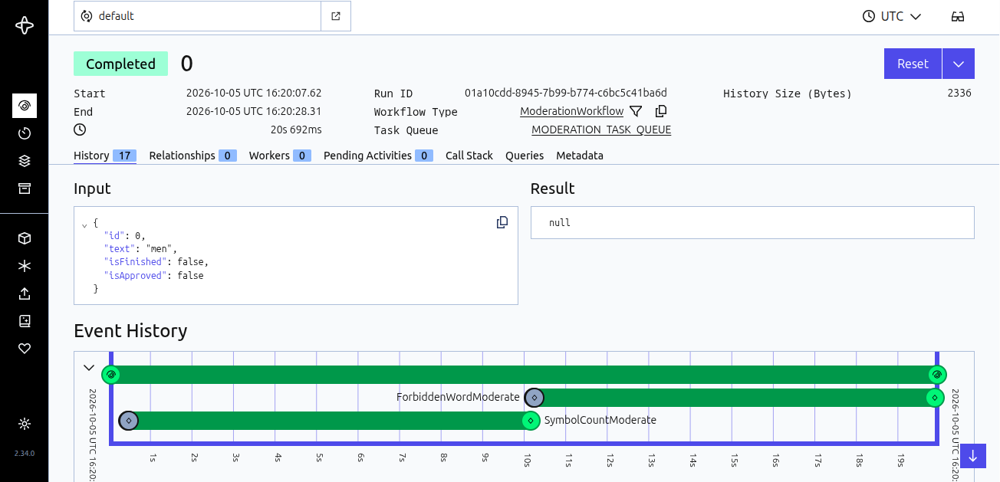

## Temporal server

### Запуск

Запуск в Docker.

Перейти в каталог Temporal /temporal_server/docker-compose

Запустить:

````shell
~/temp/temporal/docker-compose$ docker-compose up
````

Log:

````shell
Starting temporal-postgresql    ... done
Starting temporal-elasticsearch ... done
Starting temporal               ... done
Starting temporal-admin-tools   ... done
Starting temporal-ui            ... done
````

Открыть:
[http://192.168.1.20:8080](http://192.168.1.20:8080)

или

[http://192.168.1.20:8080/namespaces/default/workflows](http://192.168.1.20:8080/namespaces/default/workflows)






Примеры Temporal в [https://github.com/temporalio/samples-java.git](https://github.com/temporalio/samples-java.git)